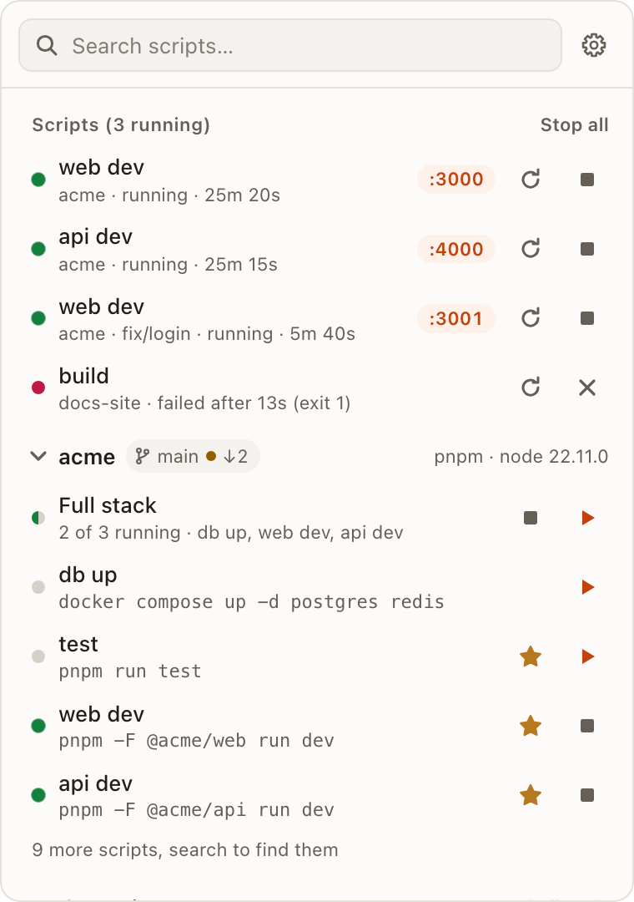
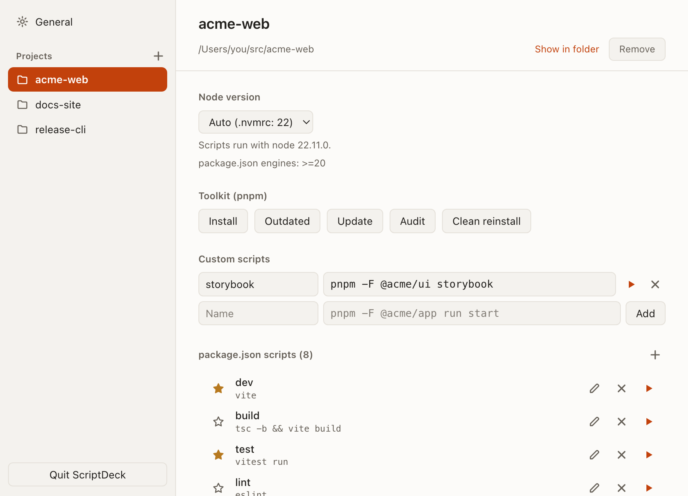

<div align="center">


# ScriptDec

**Run your `package.json` scripts from the menu bar.**

Dev servers, watchers and one-off tasks keep running in the background, each in its own real terminal.

[](https://github.com/svichas/ScriptDec/actions/workflows/ci.yml)
[](LICENSE)

<picture>
  <source media="(prefers-color-scheme: dark)" srcset="docs/popover-dark.png">
  
</picture>

</div>

## Features

- **Every script, one click away.** Root scripts, every workspace package's scripts (`pnpm -F @acme/app run start`, and the yarn, npm and bun equivalents), and your own commands.
- **Leave them running.** Each script has its own terminal. Open it from the menu bar, type into it, restart or stop it. Quitting ScriptDec stops every script it started.
- **Reopen after a restart.** Turn on Reopen running scripts, and the scripts still running when you quit, log out or update start again with ScriptDec. Ones you stopped stay stopped.
- **Find in the output.** Cmd+F (Ctrl+F on Windows) searches a terminal's whole scrollback. Cmd+click (Ctrl+click) opens any web link a script prints.
- **CPU and memory.** Hover a script's terminal tab to see what all its processes use together, like `1.2 GB · 42%`. Past 500 MB or 30% CPU, its row in the menu bar window shows it too. macOS only.
- **Search across all projects.** Click the icon or press your shortcut, type, press Enter.
- **Run with arguments.** Option-click a script's Run button (Alt-click on Windows), or press Shift+Enter on a search result, then type `--watch` or `--port 3001`. ScriptDec adds the `--` npm needs, runs it in its own terminal and remembers the arguments for next time. Save as custom script keeps the whole command.
- **Pin** the scripts you use so they stay at the top. The icon shows how many are running.
- **Groups.** Start the scripts you always run together, say web, api and a worker, with one click, and stop them the same way. Each still gets its own terminal.
- **Dev server links.** The port a script prints becomes a one-click link.
- **Port already in use.** When a script can't start because its port is taken, its row names what holds it, another script or a leftover process, and Free port stops that and restarts yours. macOS only.
- **Node per project.** Follows `.nvmrc`, `.node-version` or a Volta pin (including up the tree), or pick any version installed with nvm, fnm or Volta. Missing versions get an install button.
- **Edit `package.json` scripts.** Add, change, rename or delete them, for the root or any workspace package. Key order, indentation and line endings stay as they were.
- **Crash notifications.** A system notification when a script fails on its own. Stopping one yourself doesn't count, and neither does a failure you're watching in the terminal window.
- **Restart on crash.** Switch it on per script in Settings, and a script that dies on its own comes back after 1 s, then 2, 4, 8 and 16 s. If all five restarts crash within a minute of starting, it stays down. You get one notification as it starts restarting and one if it gives up. Stopping it yourself never restarts it.
- **Durations.** Each script shows how long it has been running, or how long it took. Installs, builds and anything else that take 30 seconds or more post a notification when they finish, unless their terminal is in front.
- **Toolkit.** Install, outdated, update, audit and clean reinstall, for pnpm, yarn, npm and bun.

## Settings

Open Settings from the gear in the menu bar window, or right-click the icon.

<picture>
  <source media="(prefers-color-scheme: dark)" srcset="docs/settings-dark.png">
  
</picture>

- **Projects.** Add a folder with the + button, or drop folders on the window. Each project has its Node version, toolkit, custom commands, groups and `package.json` scripts.
- **General.** Launch at login, reopening running scripts after a restart, a global shortcut that opens ScriptDec from any app, crash and long-task notifications on or off, a light, dark or system theme, the terminal font size, and Check for Updates.

## Install

Download the `.dmg` from the [latest release](https://github.com/svichas/ScriptDec/releases/latest), open it and drag ScriptDec to Applications.

The app is ad-hoc signed, not notarized, so macOS blocks the first launch. Open it once, then click Open Anyway in System Settings > Privacy & Security.

From 0.2.0 on, ScriptDec updates itself. When a new release is out, a banner at the bottom of the menu bar window offers it: click Update, then Restart Now once it has downloaded. It waits for you because restarting stops your running scripts.

## Build from source

You need [Rust](https://rustup.rs), [Node.js](https://nodejs.org) with [pnpm](https://pnpm.io), and the [Tauri prerequisites](https://tauri.app/start/prerequisites/) for your OS.

```bash
pnpm install
```

```bash
pnpm dev
```

```bash
pnpm test
```

```bash
pnpm build
```

`pnpm build` writes `src-tauri/target/release/bundle/macos/ScriptDec.app` (an NSIS installer on Windows).

```bash
pnpm dmg
```

`pnpm dmg` writes the app and a disk image to `src-tauri/target/release/bundle/` (macOS only). It skips the Finder step that arranges the icons, because that step needs Automation permission and is the usual reason DMG builds fail. The image still has the app and an Applications link.

## How it works

ScriptDec is a [Tauri 2](https://tauri.app) app: Rust for the processes, plain HTML and JS for the windows.

- `src-tauri/src/sessions.rs` owns the PTYs: scrollback, stop escalation (Ctrl-C, then SIGTERM, then SIGKILL on the whole tree) and URL detection.
- `src-tauri/src/project.rs` reads and edits `package.json` and finds workspaces. `node.rs` resolves Node versions across nvm, fnm and Volta.
- `ui/` has no build step. `ui/vendor/` holds xterm.js, copied from `node_modules`. The colours are the tokens at the top of `ui/app.css`.
- `src-tauri/icons/icon.svg` and `tray.svg` are the icon sources. `pnpm tauri icon` turns them into the PNG, ICNS and ICO files beside them.
- Scripts run through your login shell, so they get the same `PATH` as your terminal. The project's Node version is set after your rc files, so it wins over your version manager's default.
- `src-tauri/src/update.rs` updates the app from the latest GitHub release's `latest.json`, through the [Tauri updater](https://tauri.app/plugin/updater/). It only installs packages signed with the key whose public half is in `tauri.conf.json`.
- Projects and settings are stored in `config.json` in the app config folder (`~/Library/Application Support/com.scriptdec.desktop/` on macOS).

## Contributing

Bug reports and pull requests are welcome. See [CONTRIBUTING.md](CONTRIBUTING.md) and the [code of conduct](CODE_OF_CONDUCT.md).

## License

[MIT](LICENSE) © 2026 Stefanos Vichas. ScriptDec bundles [xterm.js](https://xtermjs.org) (MIT); its license is in `ui/vendor/`.
